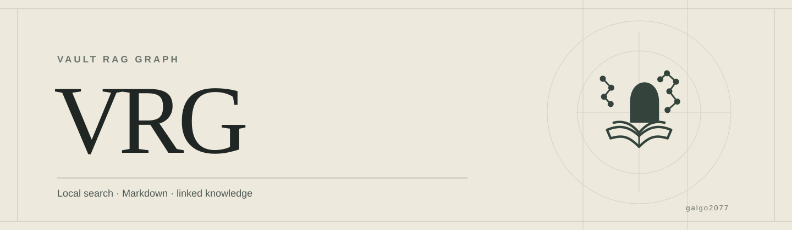

# VRG — Vault RAG Graph



**Maintained by [galgo2077](https://github.com/galgo2077)** · [Website](https://galgo2077.github.io/VRG/) · [Setup](https://galgo2077.github.io/VRG/setup.html) · [Troubleshooting](https://galgo2077.github.io/VRG/#troubleshooting) · [Support development](https://buymeacoffee.com/galgo2077?new=1)

VRG is a local-first Rust backend for retrieving information from explicitly authorized Markdown roots. It combines SQLite/FTS5 text search, optional local embeddings, and a graph of explicit note relations. The original notes remain authoritative; indexes, vectors, and graph data are rebuildable derived state.

The CLI and a local stdio Model Context Protocol (MCP) server expose attributed results with source revisions and freshness information. Codex integration can use project hooks to reconcile approved roots and check selective operational documentation at the end of a turn. MCP tools remain read-only: the assistant uses normal file tools for any separately authorized documentation edits.

## Status

The Phase 4 baseline and local integration were validated on **Void Linux**. The reported `PHASE_4_PASS`, `VRG_HOOKS_PASS`, `VRG_AUTODOC_PASS`, and `VRG_FULLY_OPERATIONAL` results apply to the recorded local configuration and tested cases; they do not establish uninterrupted operation or certify another installation. macOS and Windows have not been certified. No Phase 5 certification is claimed.

The semantic model is optional. If no usable model is configured, text search remains available and semantic retrieval is reported as unavailable or degraded. VRG does not implicitly download models. Source-note writing through MCP is disabled.

## Install from the F4 source release

The bilingual installation site is available at <https://galgo2077.github.io/VRG/>.

**Published channel:** [v0.4.0-f4 source release](https://github.com/galgo2077/VRG/releases/tag/v0.4.0-f4). The release contains code, tests, Cargo.lock and a verified Linux x86_64 archive. The archive was tested on Void Linux with glibc 2.41; it requires symbols through GLIBC 2.38 and GLIBCXX 3.4.31. [Download the archive](https://github.com/galgo2077/VRG/releases/download/v0.4.0-f4/vrg-v0.4.0-f4-linux-x86_64.tar.gz) and [checksums](https://github.com/galgo2077/VRG/releases/download/v0.4.0-f4/SHA256SUMS.txt). The official [vrg 0.1.1 crate](https://crates.io/crates/vrg/0.1.1) is published under the project owner. Version 0.1.1 was installed and smoke-tested on Void Linux x86_64. The F4 tagged source declares Cargo version **0.1.0**, whereas **v0.4.0-f4** is the Phase 4 milestone tag; later crates.io patches can carry documentation fixes.

Requirements: Git, Rust **1.92+** and Cargo, plus native build tools needed by the locked dependencies. The maintained local validation environment is Void Linux; independent macOS and Windows support is not claimed.

```sh
git clone --branch v0.4.0-f4 --depth 1 https://github.com/galgo2077/VRG.git
cd VRG
cargo build --release --locked
test -x target/release/vrg
./target/release/vrg --help
```

A first build may download dependencies. Use `cargo build --release --locked --offline` only when all locked packages are already cached.

**Next, test with a synthetic Markdown root before authorizing any private vaults.** The [complete English installation and verification guide](docs/public/SETUP.md), [guía en español](docs/public/SETUP.es.md), [web setup walkthrough](docs/setup.html) and [operator guide](docs/PUBLIC_INSTALL.md) cover isolated configuration, indexing, text and semantic retrieval, read-only MCP, Codex hook trust, continuity, troubleshooting, and directed F4 checks.

A tagged Git-source Cargo install is also possible in principle (`cargo install --git https://github.com/galgo2077/VRG.git --tag v0.4.0-f4 --locked`), but it has not been certified on a fresh external environment. It compiles locally; it is **not** a binary download.

The official crates.io package can also be installed from source. Version `0.1.1` was tested with an empty installation root and a separate build target on Void Linux x86_64:

```sh
cargo install vrg --locked
vrg --version
```

## Installation help

See the [common issues section](https://galgo2077.github.io/VRG/#troubleshooting) for Cargo dependencies, PATH, MCP configuration, hook trust, synchronization, model files and Linux compatibility. More detailed instructions are in [the setup guide](docs/public/SETUP.md) and [la guía en español](docs/public/SETUP.es.md).

## Privacy and operational boundaries

- Roots are opt-in and must be canonical absolute paths. Indexing does not edit source Markdown.
- Keep derived data, models, logs, and backups outside source roots and out of Git.
- Built-in and configured exclusions reject protected paths and private-marked notes; they are not a semantic detector for every secret or private fact.
- MCP search and read results may contain note text. A remote Codex model can receive returned excerpts; decide whether that transfer is permitted before connecting it.
- Hooks need explicit review and trust in the Codex installation. They are not activated by installing VRG, and a trusted hook's successful execution must be verified in a real session.
- The portable Unix observer requires explicit local paths and separate review before use. It is a distribution adaptation, not the exact observer used in the recorded G04 validation. Do not publish local Codex configuration or trust records.

The distributed source does not include a user’s vaults, local databases, embeddings, or credentials.
